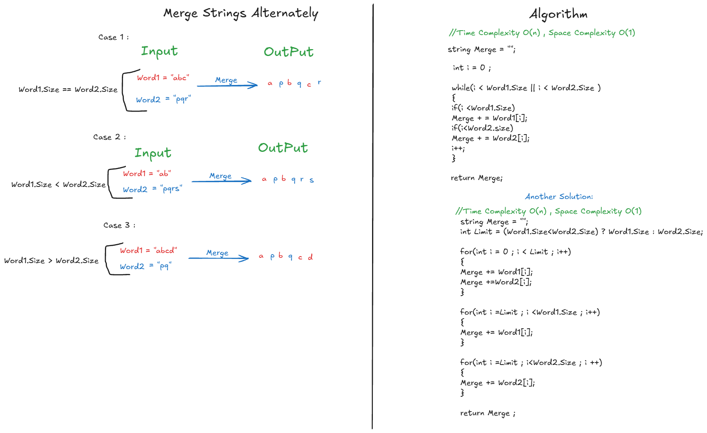

# LeetCode 1768: Merge Strings Alternately

## 📋 Problem Description
You are given two strings `word1` and `word2`. Merge the strings by adding letters in alternating order, starting with `word1`. If a string is longer than the other, append the additional letters onto the end of the merged string.

---

## 🎨 Visual Explanation (Cases & Logic)
Here is a visual breakdown of how the algorithm handles different string length cases (Click on the image to view it full size):

[](./Problem1.png)

---

## 🧠 Approach, Pseudocode & Complexity
Instead of complex multi-loop approaches, we use a single-pass `while` loop with a pointer `i` that iterates through both strings simultaneously.

```text
Algorithm MergeAlternately(Word1, Word2)
    // Input: Two strings Word1 and Word2
    // Output: A single merged string alternating characters
    
    Initialize empty string: Merge = ""
    // Initialize pointer 'i' to 0, where 'i' expresses the index of the strings
    Initialize pointer: i = 0
    
    // Loop as long as 'i' is less than the length of Word1 OR Word2
    While (i < length of Word1 OR i < length of Word2)
        
        // Check if index 'i' is still within the bounds of Word1
        If (i < length of Word1)
            Merge = Merge + Word1[i]
        End If
        
        // Check if index 'i' is still within the bounds of Word2
        If (i < length of Word2)
            Merge = Merge + Word2[i]
        End If
        
        // Increment the pointer to move to the next index
        i = i + 1
        
    End While
    
    Return Merge
End Algorithm
```

### Complexity Analysis
| Metric | Complexity | Explanation |
| :--- | :--- | :--- |
| **Time Complexity** | $O(N + M)$ | Where $N$ and $M$ are the lengths of `word1` and `word2`. The loop visits each character of both strings once. |
| **Space Complexity** | $O(1)$ | Auxiliary space used is constant, as we only use a pointer variable `i` (ignoring the output string). |